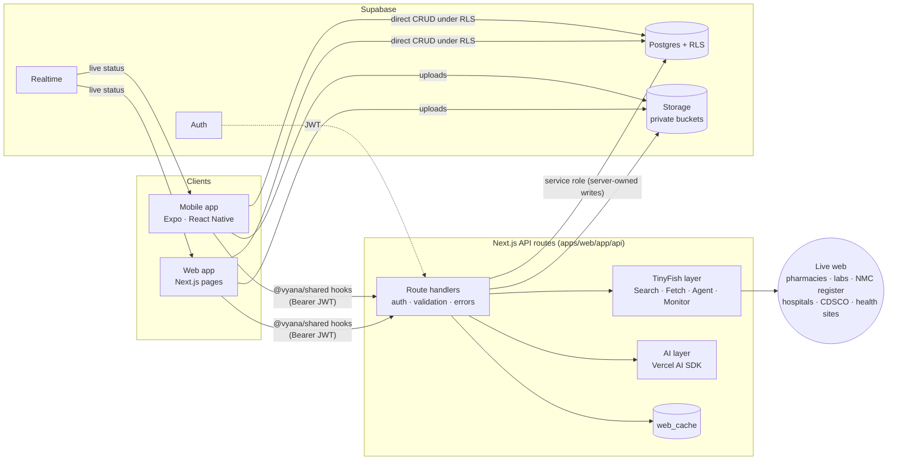
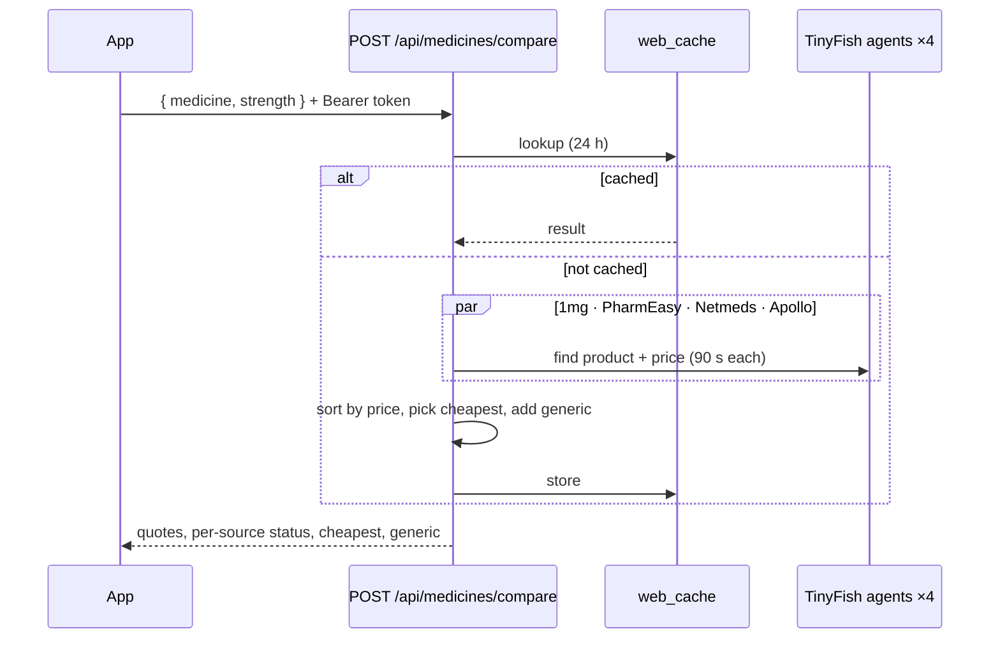

# Architecture

Vyana is a pnpm + Turborepo monorepo with two apps and one shared package. The web app also hosts the backend, so there is a single deploy.

## Packages

| Path | What it is |
|---|---|
| `apps/web` | Next.js (App Router). Patient web app, doctor portal, admin, **and** the HTTP API in `app/api/**`. |
| `apps/mobile` | Expo (React Native, Expo Router) patient app. |
| `packages/shared` (`@vyana/shared`) | Zod contracts for every API route, typed API client, React Query hooks, mock fixtures, shared constants. TypeScript source with no build step. |
| `supabase/` | Migrations, row-level security policies, seed data. |

## Two ways to reach data

| Path | Used for | Protection |
|---|---|---|
| **Direct to Supabase** (supabase-js under the user's session) | Plain reads and writes of the user's own records: profile, contacts, vitals, appointments, dose logs | Row Level Security on every table |
| **Through the API** (`/api/*`) | Anything that needs a secret or the live web: TinyFish agents, LLM calls, server-owned records | Bearer token check, Zod validation, server-only keys |

## How the live web is used (TinyFish)

| Feature | TinyFish API | What happens |
|---|---|---|
| Medicine price compare | **Agent** ×4 in parallel, Search, Fetch | Agents open 1mg, PharmEasy, Netmeds and Apollo, find the matching product and return its price as structured JSON; a Jan Aushadhi generic is looked up alongside |
| Lab test price compare | **Agent** ×4 | Same pattern on Healthians, Redcliffe, Thyrocare and 1mg Labs |
| Doctor verification | **Agent** | Searches the NMC Indian Medical Register for a registration number and returns the official record |
| Nearby emergency hospitals | **Search** + **Fetch** | Finds hospitals with emergency/ICU care near the user and extracts names, addresses and phone numbers |
| Assistant citations, diet plans | **Search** + **Fetch** | Restricted to trusted health domains; sources are shown with every answer |
| Medicine quality alerts | **Monitor** + **Search** + **Fetch** | A monitor watches CDSCO quality alerts and calls a webhook; matches against users' medicines become push notifications |

Web results are cached in Postgres (`web_cache`), so repeated lookups are instant and cost nothing.

## Medicine compare, step by step

If some pharmacies time out, the response still succeeds with the rest, and each source's status is reported.

## Contracts

Every API route has a request and response schema in `packages/shared/src/contracts`. The server validates what it receives and the client validates what it gets back. JSON uses snake_case, the same as the database columns. The public reference [`apps/web/openapi.yaml`](apps/web/openapi.yaml) is generated from these schemas (`pnpm docs:openapi`), and CI fails if it is out of date.

## Security boundaries

- Only `apps/web` server code holds secrets (Supabase service role, TinyFish, LLM). The mobile app and the browser never see them.
- The service-role client is used only for server-owned writes, after an explicit ownership check.
- Content from the web is treated as untrusted data, never as instructions.
- See [`.github/SECURITY.md`](.github/SECURITY.md) for reporting.

## CI

Every pull request runs: lint + typecheck (+ OpenAPI drift check), unit tests, web production build, expo-doctor, CodeQL, secret scanning, dependency review and a Conventional Commit title check. `main` accepts changes only through pull requests that pass them.
