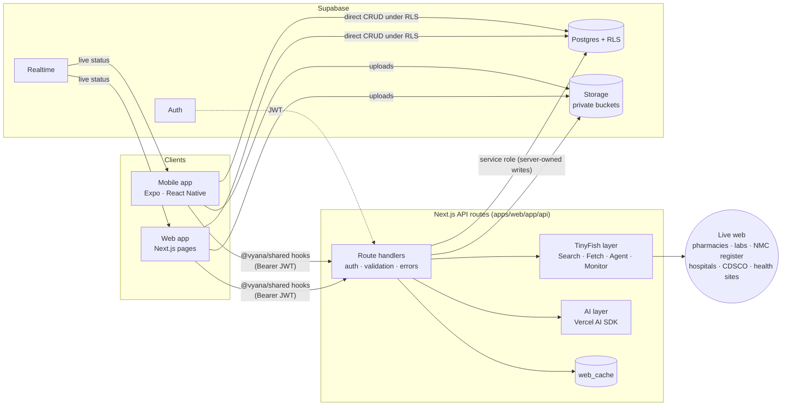
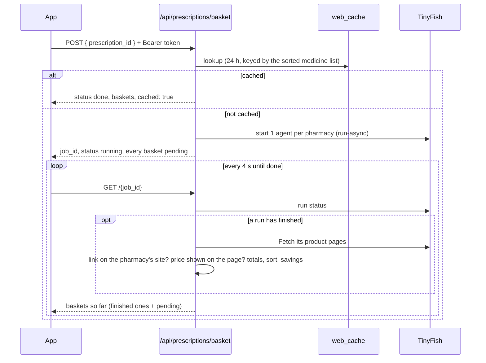

# Architecture

Vyana is a pnpm + Turborepo monorepo with two apps and one shared package. The web app also hosts the backend, so there is a single deploy.

## Packages

| Path | What it is |
|---|---|
| `apps/web` | Next.js (App Router). Patient web app, doctor portal, admin, **and** the HTTP API in `app/api/**`. |
| `apps/mobile` | Expo (React Native, Expo Router) patient app. |
| `packages/shared` (`@vyana/shared`) | Zod contracts for every API route, typed API client, React Query hooks, mock fixtures, shared constants. TypeScript source with no build step. |
| `supabase/` | Migrations, row-level security policies, seed data. |

## Two ways to reach data

| Path | Used for | Protection |
|---|---|---|
| **Direct to Supabase** (supabase-js under the user's session) | Plain reads and writes of the user's own records: profile, contacts, vitals, appointments, dose logs | Row Level Security on every table |
| **Through the API** (`/api/*`) | Anything that needs a secret or the live web: TinyFish agents, LLM calls, server-owned records | Bearer token check, Zod validation, server-only keys |

## How the live web is used (TinyFish)

| Feature | TinyFish API | What happens |
|---|---|---|
| Prescription basket → delivery | **Agent** ×4 (async), **Fetch** | One agent per pharmacy (1mg, PharmEasy, Netmeds, Apollo) finds every medicine on the prescription and returns prices as structured JSON; each price is then confirmed on the product page with Fetch; totals, missing items and savings are computed in code; the user orders on the cheapest pharmacy |
| Doctor verification | **Agent** | Searches the NMC Indian Medical Register for a registration number and returns the official record |
| Hospital OPD timings | **Search** + **Fetch** | Department-wise OPD timings for the hospital page in booking, with the source link |
| Nearby emergency hospitals | **Search** + **Fetch** | Hospitals with emergency/ICU care near the user, with phone numbers taken from the source page |
| Care plans, interaction checks, assistant | **Search** + **Fetch** | Restricted to trusted health domains; every statement keeps its source |
| Medicine quality alerts | **Monitor** + **Search** + **Fetch** | A monitor watches CDSCO quality alerts and calls a webhook; matches against users' medicines become push notifications |

Web results are cached in Postgres (`web_cache`), so repeated lookups are instant and cost nothing.

## Prescription basket, step by step

Browser agents take one to a few minutes per pharmacy, so pricing runs as a background job that the app polls.

- The `job_id` is the job itself, encrypted and signed by the server, so no job table is needed and its contents can't be read or changed by the client. Only the user who started a job can read it.
- A price that the product page doesn't show is returned as unconfirmed and left out of totals, so it can never make a basket look cheapest.
- If a pharmacy times out or lacks a medicine, the job still finishes and says so per pharmacy.

## AI safety

Vyana treats AI output as a draft that must be proven, never as fact:

| Rule | How it is enforced |
|---|---|
| No invented doses, prices, values or links | Extracted fields carry the exact text they came from, and the server checks that text appears in the document; prices must come from the pharmacy's own page and pass range checks; links must be pages the server actually fetched |
| Code decides, AI explains | Lab flags come from reference ranges in code; emergency warning signs come from fixed rules that run before any model; totals and savings are computed in code |
| Structured output only | Every model call returns a schema-validated object at temperature 0; invalid output is retried once, then the user is asked to enter it manually |
| A human confirms | Patients review every scanned prescription before reminders are set; doctors approve care plans for their diagnoses |
| Say "I don't know" | Missing or conflicting sources mean the app says so and points to a doctor or 108; it never diagnoses and never calls a combination "safe" |
| Traceable | Each AI result is stored with the model, prompt version and sources; users can report a mistake |
| Privacy before AI | Names, phone numbers, addresses and ID numbers are removed from text before it reaches a model; prescription and report images go only to a provider whose terms rule out keeping or training on them |
| Streaming answers stay checked | The assistant's reply passes through a filter as it streams: a link is held until it is complete and removed unless the server fetched it from a trusted health site in that request; emergency warning signs make the server write a fixed 108 / SOS notice before the AI answers |
| Care plans quote their pages | Every care plan bullet carries the sentence it came from, checked against the fetched page; follow-up intervals are computed from those sentences; warning signs include a reviewed, quoted list per condition (`pnpm verify:red-flags`) |
| Verified interaction data | Well-known dangerous medicine combinations come from a reviewed table checked in code; anything else needs a quoted, trusted source |

## Contracts

Every API route has a request and response schema in `packages/shared/src/contracts`. The server validates what it receives and the client validates what it gets back. JSON uses snake_case, the same as the database columns. The public reference [`apps/web/openapi.yaml`](apps/web/openapi.yaml) is generated from these schemas (`pnpm docs:openapi`), and CI fails if it is out of date.

## Security boundaries

- Only `apps/web` server code holds secrets (Supabase service role, TinyFish, LLM). The mobile app and the browser never see them.
- The service-role client is used only for server-owned writes, after an explicit ownership check.
- Content from the web is treated as untrusted data, never as instructions.
- See [`.github/SECURITY.md`](.github/SECURITY.md) for reporting.

## Deployment

The web app and API run as one container (Next.js standalone build) behind Caddy, which handles HTTPS, on a single server with Docker Compose: `Dockerfile`, `docker-compose.yml` and `Caddyfile` at the repository root. Supabase (Postgres, Auth, Storage, Realtime) is a hosted project. Secrets live in an env file on the server, outside git and outside the image; only the two public `NEXT_PUBLIC_*` values are passed in while the image is built. Start it with `docker compose --env-file apps/web/.env.production up -d --build`.

## CI

Every pull request runs: lint + typecheck (+ OpenAPI drift check), unit tests, web production build, expo-doctor, CodeQL, secret scanning, dependency review and a Conventional Commit title check. `main` accepts changes only through pull requests that pass them.
