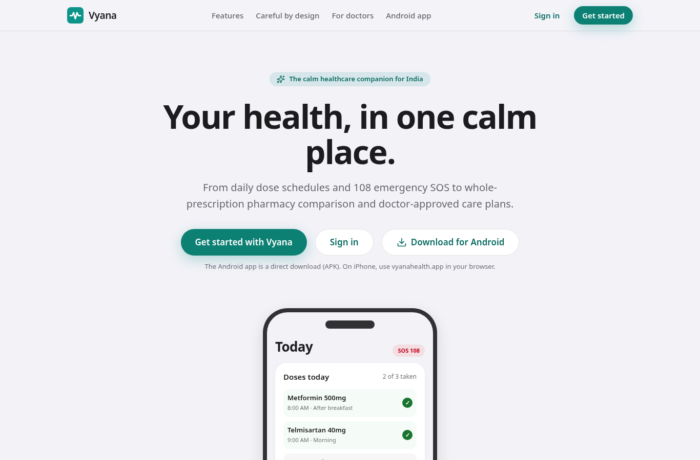
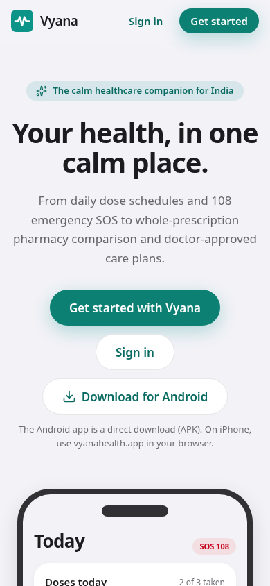
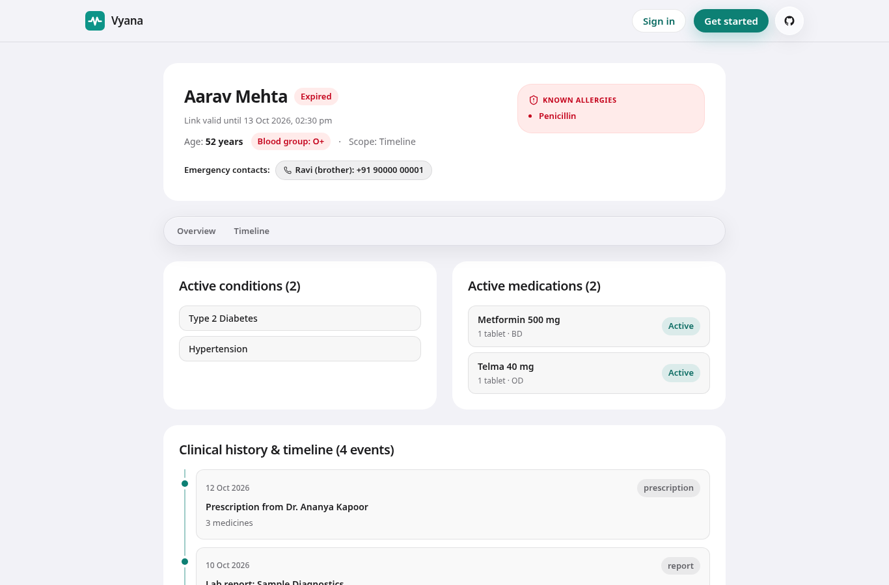
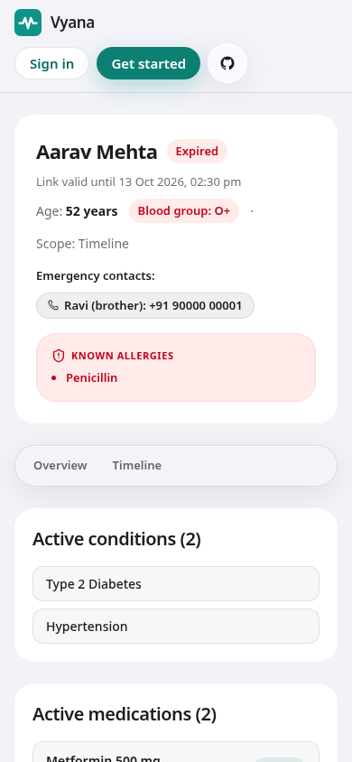

# Vyana

[](https://github.com/piyushgargog/vyana/actions/workflows/ci.yml) [](https://github.com/piyushgargog/vyana/actions/workflows/codeql.yml) [](https://github.com/piyushgargog/vyana/actions/workflows/security.yml) [](https://github.com/piyushgargog/vyana/actions/workflows/container-security.yml) [](https://github.com/piyushgargog/vyana/actions/workflows/dynamic-security.yml) [](https://github.com/piyushgargog/vyana/actions/workflows/uptime.yml) [](https://github.com/piyushgargog/vyana/actions/workflows/scorecard.yml)

> *Your health, in one calm place.*

**Vyana is your online one-stop solution for complete healthcare**, with a personal AI assistant inside. Book hospital appointments with a token (like the government ORS portal), keep prescriptions and reports in one timeline, find your medicines at pharmacies straight from your prescription, never miss a dose or a refill, follow a care plan after a diagnosis, and get help fast in an emergency. All on web and mobile.

Its AI web agents, powered by [TinyFish](https://tinyfish.ai), go out across the live web (pharmacies, labs, blood banks, the NMC medical register, hospitals) and bring back what your health needs.

**Live:** [vyanahealth.app](https://vyanahealth.app) (web app and API, hosted in Mumbai behind Cloudflare). Sign up with an email address; please use made-up details only, not your real health data.

**Android app:** the installable preview (APK) is attached to each [release](https://github.com/piyushgargog/vyana/releases); how it is built: [`apps/mobile/BUILD.md`](apps/mobile/BUILD.md). It talks to the same live backend, so the demo accounts work in both.

*A portfolio project by four developers.*

---

## Features

| | Feature | What it does |
|---|---|---|
| 💊 | **Prescriptions, reminders and refills** | Scan a prescription or receive one from your doctor, review it, and get dose reminders with adherence tracking. Vyana warns you before a medicine runs out |
| 🛒 | **Medicines from your prescription** | Opens each medicine of your prescription on 1mg, PharmEasy, Netmeds and Apollo (plain links: Vyana shows no price, the pharmacy's own page does) |
| 🏥 | **Hospital appointments with a token** | Pick a hospital, department and date and get a token number, like the government ORS portal; open the hospital's own website for its timings |
| 🩺 | **Verified doctors and e-prescriptions** | A Vyana admin checks each doctor's registration against the public register by hand; verified doctors write e-prescriptions with a diagnosis |
| 📋 | **Care plan after a diagnosis** | What to do, what to avoid, what to eat, warning signs and follow-up tests, from trusted health sources and **approved by your doctor** |
| 🧪 | **Reports and health timeline** | Upload a lab report and get flagged values and a plain-language summary; every prescription, report and visit in one timeline you can share with a doctor |
| 🤖 | **AI health assistant** | Chat in English, Hindi or Hinglish; it knows your medicines and reports and cites trusted sources |
| 🚑 | **Emergency** | One tap calls 108, shares your live location, opens Blinkit Ambulance where available, lists nearby emergency hospitals, and shows your medical ID QR |
| 👨‍👩‍👧 | **Caregiver mode** | Family members can follow a patient's medicines and get an alert when a dose is missed |
| ⚠️ | **Safety checks** | Drug interaction warnings across prescriptions, a symptom check that points you to the right department or to 108 |
| 🔎 | **More from the live web** | Links to labs for test prices and to the official Ayushman Bharat (PM-JAY) hospital finder |
| 🩸 | **RapidBlood** | Look up blood stock by blood group and component in your city and nearby cities, from the public e-RaktKosh stock page. Vyana lists the blood banks it finds and tracks your blood requests; you call the bank to confirm |
| 🧠 | **Health Memory Graph** | Share a timeline link for 24 hours, 7 days or 30 days with only the parts you pick: labs, vitals, medicines or adherence. The doctor sees lab trends, vitals, medicines over time and a 30 day adherence strip, all drawn from your stored records, with no AI-written text; you see how many times the link was opened |
| 🔒 | **Your data, your control** | Consent at sign-up, download all your data, delete your account any time |

## Screens

| Home (desktop) | Home (phone) |
|---|---|
| [](docs/images/home-desktop.png) | [](docs/images/home-phone.png) |

| Shared record — what a doctor sees (desktop) | Shared record — what a doctor sees (phone) |
|---|---|
| [](docs/images/share-desktop.png) | [](docs/images/share-phone.png) |

More screens (Today, Ask Vyana, a care plan, blood search, SOS and the rest) are captured with [`docs/images/capture-screens.mjs`](docs/images/capture-screens.mjs) against the demo patient — see [`docs/images/README.md`](docs/images/README.md).

## How TinyFish is used

Full details, with the request flow, are in [`ARCHITECTURE.md`](ARCHITECTURE.md).

| Feature | TinyFish API | Endpoint | Code |
|---|---|---|---|
| Prescription basket price compare (delivery) | **Agent**: one agent per pharmacy prices the whole basket in the background; each price is then confirmed on the product page with **Fetch** | `POST /api/prescriptions/basket`, `GET /api/prescriptions/basket/{job_id}` | [`tinyfish/basket.ts`](apps/web/lib/server/tinyfish/basket.ts) |
| Doctor verification | No agent: an admin checks the public register by hand and records the decision; the server compares the saved registration | `POST /api/doctors/verify` | [`doctor-verify.ts`](apps/web/lib/server/doctor-verify.ts) |
| Hospital OPD timings | **Search** + **Fetch**; a page counts only when it can be tied to the hospital, and days and timings must be on it | `POST /api/hospitals/info` | [`tinyfish/hospitals.ts`](apps/web/lib/server/tinyfish/hospitals.ts) |
| Nearby emergency hospitals | Not TinyFish: OpenStreetMap (Overpass) plus the seeded hospitals table | `POST /api/emergency/nearby`, `POST /api/emergency/sos` | [`web/overpass.ts`](apps/web/lib/server/web/overpass.ts) |
| Care plans | Not TinyFish: direct reads of trusted guideline pages (MedlinePlus search + our own page fetch); every bullet quotes its page | `POST /api/care-plan` | [`care-plan.ts`](apps/web/lib/server/care-plan.ts) |
| Drug interaction check | No web lookup at runtime: a reviewed table in code; pairs it does not cover are listed as not checked | `POST /api/medicines/interactions` | [`interactions.ts`](apps/web/lib/server/interactions.ts) |
| AI assistant | Direct web readers as the assistant's tools (MedlinePlus + page fetch), trusted health sites only; only links returned by the assistant's tools can reach the screen | `POST /api/assistant/chat` | [`assistant/tools.ts`](apps/web/lib/server/assistant/tools.ts) |
| Lab test price compare | **Agent** per lab in the background; each price is confirmed on the lab's page with **Fetch** | `POST /api/labs/compare`, `GET /api/labs/compare/{job_id}` | [`tinyfish/labs.ts`](apps/web/lib/server/tinyfish/labs.ts) |
| PM-JAY hospitals | **Search** + **Fetch**, government pages only | `POST /api/schemes/pmjay-hospitals` | [`tinyfish/hospitals.ts`](apps/web/lib/server/tinyfish/hospitals.ts) |

**RapidBlood** does not use TinyFish either: it reads the public e-RaktKosh stock service directly (the searched city and up to three nearby cities, about a second), through `POST /api/blood/search` and `GET /api/blood/search/{job_id}` ([`blood.ts`](apps/web/lib/server/blood.ts), [`web/eraktkosh.ts`](apps/web/lib/server/web/eraktkosh.ts)). Every row is what the source itself answered, so every row is marked verified. Results are cached for 15 minutes. RapidBlood does not reserve or move blood: it lists what the source showed, with the time the source gave, and tells the patient to call the blood bank.

Every TinyFish call goes through one client ([`tinyfish/client.ts`](apps/web/lib/server/tinyfish/client.ts)) with timeouts, a per-minute agent limit and an offline mock mode. Public results are cached in Postgres, and `pnpm prewarm` fills the cache before a demo. Live checks: `pnpm smoke:tinyfish`, `pnpm smoke:basket`, and `pnpm verify:interactions`, `verify:red-flags` and `verify:brands`, which re-check the reviewed safety lists against their source pages.

## AI you can trust

Health decisions can't rest on a guess. Vyana's AI never invents a dose, a price, a lab value or a source:
- Extracted values must appear in the original document, and anything uncertain is flagged for you to review.
- Citations are checked against the pages actually read.
- Warning signs are caught by fixed rules before any AI runs.
- Care plans for a diagnosis are approved by the doctor.

Details: [`ARCHITECTURE.md`](ARCHITECTURE.md#ai-safety).

## Tech stack

**Web:** Next.js · Tailwind · shadcn/ui
**Mobile:** Expo (React Native) · Expo Router
**Backend:** Next.js Route Handlers
**Database:** Supabase (Postgres, Auth, Storage, Realtime)
**Web agents:** TinyFish
**AI:** Vercel AI SDK, provider-agnostic (Gemini, Groq, NVIDIA, OpenRouter, Hugging Face)
**Hosting:** Docker Compose · Caddy · Cloudflare, on one server
**Tooling:** TypeScript · pnpm + Turborepo

## Repository layout

```
apps/web         Next.js: patient web, doctor portal, admin, API routes
apps/mobile      Expo: patient mobile app
packages/shared  @vyana/shared: contracts, types, API client, data hooks
supabase/        migrations, RLS policies, seed data, database tests
scripts/         live checks, safety evaluation, cache prewarm, OpenAPI generator
Dockerfile · docker-compose.yml · Caddyfile    deployment
```

## Getting started

Requirements: Node.js 24 (see [`.nvmrc`](.nvmrc)) and pnpm (`npm i -g pnpm`).

```bash
git clone https://github.com/piyushgargog/vyana.git
cd vyana
pnpm install
pnpm dev:web       # http://localhost:3000
pnpm dev:mobile    # Expo dev server (scan the QR code with Expo Go)
```

Environment variables: copy `apps/web/.env.example` and `apps/mobile/.env.example` to `.env.local` / `.env` and fill them in.

Useful checks: `pnpm live:check` (the API against a running Supabase), `pnpm eval:safety` (AI safety cases per provider), `pnpm prewarm` (fill the cache before a demo).

**End-to-end tests** (`tests/e2e`, Playwright): `pnpm e2e` runs the patient, doctor and public-page flows against `E2E_BASE_URL` (default `http://localhost:3000`). They need the demo passwords from the environment (`E2E_PASSWORD_PATIENT`, `E2E_PASSWORD_DOCTOR`); against the live site the CI workflow `.github/workflows/e2e.yml` runs them nightly with repository secrets. The tests never create data that stays.

**Deploy:** `docker compose --env-file apps/web/.env.production up -d --build` runs the app behind Caddy on any server with Docker; see [Deployment](ARCHITECTURE.md#deployment).

## Documentation

| Doc | What it covers |
|---|---|
| [`ARCHITECTURE.md`](ARCHITECTURE.md) | How the apps, API, database and web agents fit together |
| [`apps/web/openapi.yaml`](apps/web/openapi.yaml) | HTTP API reference (OpenAPI 3.1, generated from the contracts) |
| [`CHANGELOG.md`](CHANGELOG.md) | What changed and when |
| [`apps/web/tests/README.md`](apps/web/tests/README.md) | How the backend is tested |
| [`supabase/README.md`](supabase/README.md) · [`supabase/DATA-FLOW.md`](supabase/DATA-FLOW.md) | Database setup and how data moves between the phone, Supabase, the API and the AI model |
| [`apps/mobile/BUILD.md`](apps/mobile/BUILD.md) | Building the Android preview (APK) |
| [`AGENTS.md`](AGENTS.md) | Rules for AI coding agents working in this repo |
| [`ACCESSIBILITY.md`](.github/ACCESSIBILITY.md) | Accessibility target (WCAG 2.2 AA) and how to report a barrier |

## Contributing

We work in feature branches and merge through pull requests only. Read [`CONTRIBUTING.md`](.github/CONTRIBUTING.md) before your first PR. Everyone taking part follows our [Code of Conduct](.github/CODE_OF_CONDUCT.md).

## Team

| | Role |
|---|---|
| **Piyush Garg** ([@piyushgargog](https://github.com/piyushgargog)) | Team Lead · Backend |
| **Arvind Kushwaha** ([@arvindkushwaha55](https://github.com/arvindkushwaha55)) | Frontend (web + mobile) |
| **Vaibhav Parmar** ([@vaibhavparmarog](https://github.com/vaibhavparmarog)) | Database + data layer |
| **Kareena Sah** ([@middaymyse](https://github.com/middaymyse)) | Product |

## Disclaimer

Vyana is a portfolio project. It is **not** a substitute for professional medical advice, diagnosis or treatment. In an emergency, call **108**.

## License

[MIT](LICENSE)
