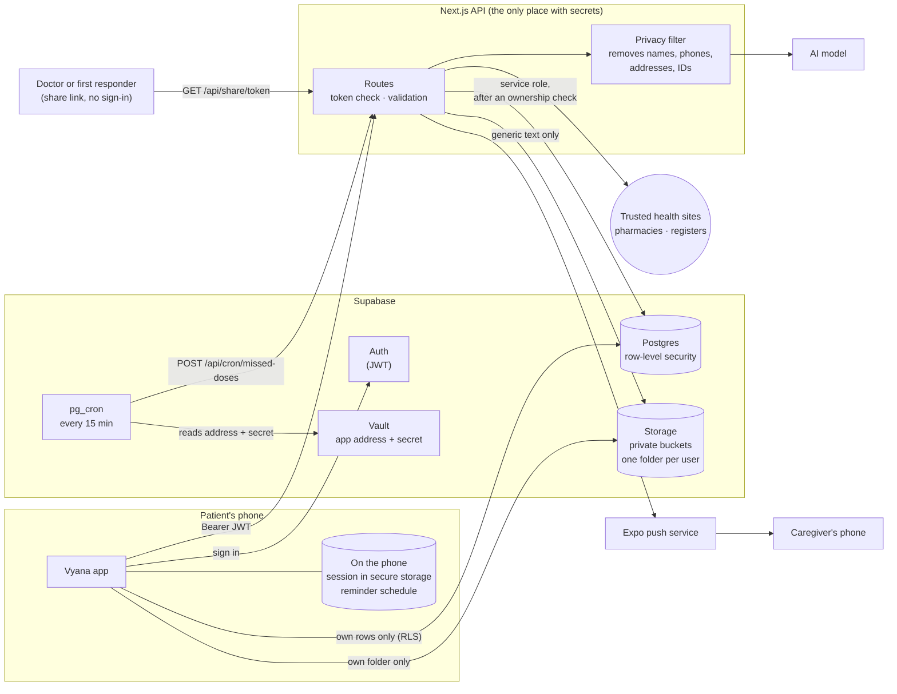
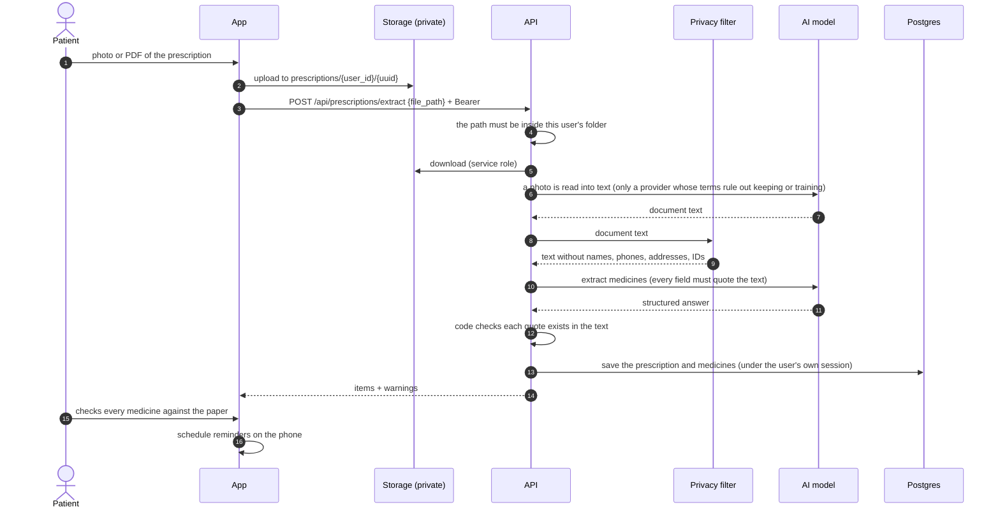
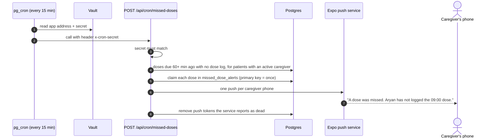
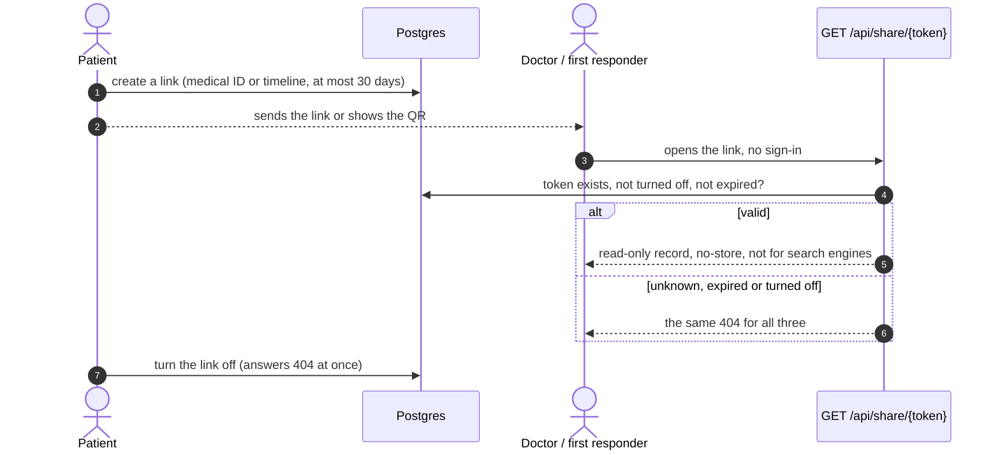

# Data flow

How a patient's data moves through Vyana, who can reach it at each step, and what protects it. It follows the code in this repository; [`ARCHITECTURE.md`](../ARCHITECTURE.md) has the overview of the apps and [`README.md`](README.md) the database.

## The big picture

Two rules hold everywhere:

1. **A user reaches only their own rows.** Plain reads and writes go straight from the app to Postgres under row-level security. Everything else goes through the API, which checks the Bearer token first and uses the service-role key only after an explicit ownership check.
2. **Secrets never leave the server.** The phone and the browser hold the public Supabase key and the user's own session, nothing else.

## Flow 1: scanning a prescription

What is stored: the uploaded file (private bucket, the user's folder), the saved medicines, and a record of the AI run (model, prompt version, sources) so a mistake can be reported. Reminders are scheduled on the phone itself; their text leaves out medicine names unless the user turns that on.

## Flow 2: a missed dose reaches the caregiver

The lock screen shows the first name and the time, never a medicine, batch or condition. The claim is written before the push is sent, so two runs at the same moment cannot alert twice; if the push service cannot be reached, the claim is released and the next run tries again.

## Flow 3: sharing a record with a doctor or a first responder

A medical-ID link shows name, age, blood group, allergies, active conditions and medicines, and emergency contacts. A timeline link drops the contacts and adds the history. Neither shows the patient's id, phone number or the token.

## What the user controls

| Control | What happens |
|---|---|
| **Consent** | Asked at sign-up and stored with its version (`consents`) |
| **Download my data** | `GET /api/me/export`: every row the user owns, keyed by table, and their files with one-hour links. Tokens and codes that open data to somebody else are left out |
| **Delete my account** | `DELETE /api/me` (after a sign-in within 15 minutes): the user's files go first, then the account, and every row of the patient goes with it |
| **Caregiver access** | Joined with a 24-hour code; turned off by either side |
| **Share links** | Expire within 30 days; turned off at any time |

## Who can see what

| Data | The patient | A caregiver | A doctor | Anyone with a share link | The server |
|---|---|---|---|---|---|
| Profile, medicines, doses, reports, vitals | yes | yes, read only, while the link is active | only for patients of their own verified department | only what the link shows, until it expires | to do the work asked; health data is kept out of the logs |
| Uploaded files | yes (own folder) | no | no | no | to read the scan |
| Push token | yes | no | no | no | to send the alert |
| Link tokens, caregiver codes | yes | no | no | no | to check them |
